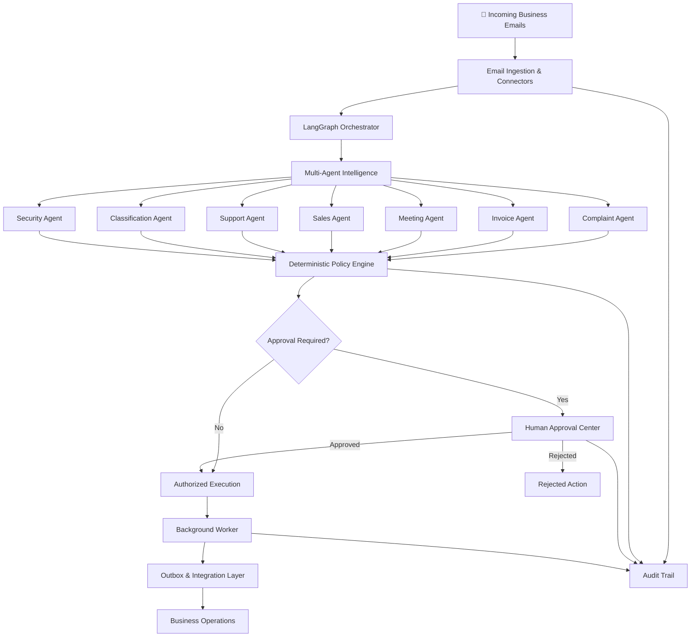
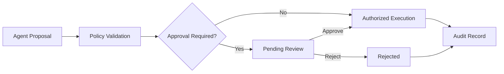

 <div align="center">

# AEOP
### AUTONOMOUS EMAIL OPERATIONS PLATFORM

**Intelligent Multi-Agent Automation. Deterministic Governance. Human-Controlled Execution.**

A next-generation enterprise email operations platform that transforms incoming business emails into structured, intelligent, and auditable workflows.

<br/>

**AGENTS PROPOSE** → **POLICIES DECIDE** → **HUMANS APPROVE** → **EVERYTHING IS AUDITED**

<br/>

[](https://www.python.org/)
[](https://fastapi.tiangolo.com/)
[](https://www.langchain.com/langgraph)
[](./docs/IMPLEMENTATION_STATUS.md)
[](./docs/)

<br/>

**[QUICK START](#-quick-start)** · **[ARCHITECTURE](#-system-architecture)** · **[FEATURES](#-platform-capabilities)** · **[DOCUMENTATION](#-documentation)**

<br/>

</div>

---

## 01 — Overview

### Beyond Email Automation. Intelligent Business Operations.

Modern organizations receive thousands of emails containing customer complaints, support requests, invoices, meeting requests, sales opportunities, and operational information.

Processing these emails manually creates operational bottlenecks, increases response times, and introduces human errors.

**AEOP solves this challenge through a controlled multi-agent AI architecture.**

Rather than building another email chatbot, AEOP introduces specialized AI agents that understand business emails, propose structured actions, and coordinate operational workflows under deterministic policy enforcement.

The platform ensures that AI autonomy never comes at the expense of business control.

### The Core Philosophy

| Traditional Email Management | AEOP |
|---|---|
| Manual email classification | Intelligent agent-based classification |
| Repetitive manual processing | Automated business workflows |
| Uncontrolled AI decisions | Deterministic policy enforcement |
| Manual action coordination | Orchestrated multi-agent execution |
| Limited accountability | Complete auditability |
| Isolated email operations | Extensible integration architecture |

---

## 02 — Platform Capabilities

### Everything Needed for Controlled Email Operations

<table>
<tr>
<td width="50%" valign="top">

### 🧠 Multi-Agent Intelligence

- LangGraph orchestration
- Seven specialized agents
- Structured agent outputs
- Business workflow coordination
- Gemini integration
- Local heuristic fallback

</td>
<td width="50%" valign="top">

### ⚖️ Deterministic Governance

- Central policy engine
- Business rule validation
- Action authorization
- Human approval requirements
- Risk-aware execution
- Controlled autonomy

</td>
</tr>
<tr>
<td width="50%" valign="top">

### 📬 Email Operations

- Complaint processing
- Customer support
- Invoice workflows
- Meeting coordination
- Sales lead processing
- Newsletter classification
- Ambiguous email handling

</td>
<td width="50%" valign="top">

### 🛡️ Enterprise Security

- Role-Based Access Control
- Multi-tenant isolation
- Prompt-injection handling
- Audit chain
- Controlled execution
- Organization-level access

</td>
</tr>
<tr>
<td width="50%" valign="top">

### ⚙️ Operational Reliability

- Background worker
- Retry mechanisms
- Dead-letter handling
- Transactional outbox
- SLA escalation
- Workflow monitoring

</td>
<td width="50%" valign="top">

### 🔌 Integration Architecture

- Gmail OAuth connector
- Microsoft Outlook OAuth connector
- Email synchronization
- Email sending code
- Webhook support
- CRM and business adapter interfaces

</td>
</tr>
</table>

---

## 03 — System Architecture

### Designed for Controlled Agentic Execution

AEOP separates intelligent decision-making from actual business execution.

AI agents are responsible for understanding and proposing actions. The deterministic policy layer controls whether those actions are authorized.

This separation creates a safer architecture for business automation.



### Four Layers of Controlled Autonomy

**01. Intelligence Layer**

Specialized agents analyze incoming emails, identify business intent, extract information, and propose structured operations.

**02. Governance Layer**

A deterministic policy engine validates proposed actions against configured business rules and authorization requirements.

**03. Human Oversight Layer**

Sensitive operations can be routed to the approval center for human review before execution.

**04. Execution & Audit Layer**

Authorized operations are processed through background workers and execution mechanisms, with important decisions and actions recorded for auditing.

---

## 04 — Business Workflows

### Real-World Business Scenarios

AEOP is designed around practical business email operations rather than generic conversational interactions.

| Workflow | Business Problem | Automated Responsibility |
|---|---|---|
| Customer Complaints | Delayed complaint handling | Identify, classify, and propose responses |
| Customer Support | Repetitive support requests | Understand requests and propose resolutions |
| Invoice Operations | Manual invoice processing | Identify invoice-related information and workflow |
| Meeting Coordination | Time-consuming scheduling emails | Identify meeting requests and propose actions |
| Sales Intelligence | Missed sales opportunities | Identify potential leads |
| Newsletter Management | Unnecessary inbox clutter | Identify promotional emails |
| Security Handling | Malicious email instructions | Handle prompt-injection scenarios |
| Ambiguous Requests | Unclear customer intent | Flag uncertain cases for review |

### Demonstration Scenarios

The platform includes 12 synthetic email scenarios:

- 1 customer complaint
- 1 customer support request
- 5 invoice cases
- 1 meeting request
- 1 sales lead
- 1 prompt-injection case
- 1 newsletter
- 1 ambiguous email

These scenarios run through the actual application pipeline and can be reviewed in the dashboard's Approval Center.

---

## 05 — Technology Stack

### Built with Modern Backend and Agentic AI Technologies

| Layer | Technology | Responsibility |
|---|---|---|
| Programming Language | Python | Core application logic |
| Backend Framework | FastAPI | REST API and application services |
| Agent Orchestration | LangGraph | Multi-agent workflow coordination |
| LLM Provider | Google Gemini | AI-assisted email processing |
| Database | SQLite / PostgreSQL support | Persistent application data |
| Migrations | Alembic | Database schema management |
| Background Processing | Python Worker | Asynchronous operations |
| Authentication | Application authentication | User access |
| Authorization | RBAC | Role-based permissions |
| Email Providers | Gmail / Microsoft Outlook | Email connectivity |
| API Documentation | OpenAPI / Swagger | API exploration |
| Testing | Pytest | Automated backend tests |
| Deployment Configuration | Docker support | Containerization configuration |

---

## 06 — Quick Start

### Get AEOP Running in One Command

The application is designed to initialize and start the API, background worker, and dashboard together.

#### Prerequisites

- Python 3.11+ recommended, subject to dependency compatibility.
- Git.
- Internet connection for initial dependency installation.

#### Step 01 — Clone the Repository

```bash
git clone https://github.com/WaheedAbbas199/aeop-email-operations.git
```

#### Step 02 — Enter the Project Directory

```bash
cd aeop-email-operations
```

#### Step 03 — Start AEOP

```bash
python main.py
```

**That's it.** On first startup, the application installs the required dependencies and starts its services.

#### Step 04 — Open the Dashboard

<div align="center">

### 🚀 AEOP Dashboard

**http://127.0.0.1:8000**

</div>

#### Step 05 — Explore the API

| Resource | URL |
|---|---|
| Interactive API Documentation | `http://127.0.0.1:8000/api/docs` |
| Health Check | `/api/v1/health` |
| Readiness Check | `/api/v1/ready` |

---

## 07 — Initial Configuration

### Administrator Account

On first startup, AEOP automatically creates an administrator account.

Credentials are written to:

```text
data/first_run_credentials.txt
```

Alternatively, administrator credentials can be configured through environment variables:

```env
ADMIN_EMAIL=admin@example.com
ADMIN_PASSWORD=your-secure-password
```

**Security:** Keep administrator credentials and generated credential files out of version control.

### Environment Configuration

Create or configure your `.env` file using the project's environment template.

```env
GEMINI_API_KEY=your_gemini_api_key

ADMIN_EMAIL=admin@example.com
ADMIN_PASSWORD=your-secure-password

ALLOW_SIGNUP=true
```

Use the actual environment variable names supported by your application configuration.

### AI Engine Modes

**Gemini Mode**

When a valid Gemini API key is configured, the application can use its Gemini integration for AI-assisted processing.

**Local Heuristic Mode**

When `GEMINI_API_KEY` is not configured, the application uses deterministic local heuristics.

The dashboard identifies this execution mode as:

```text
local-heuristic
```

This allows the core platform and demonstration workflows to operate without an external LLM API key.

### Organization Registration

AEOP supports self-service organization registration.

Every successful signup creates a separate organization with tenant isolation.

Public registration can be disabled:

```env
ALLOW_SIGNUP=false
```

---

## 08 — Human Approval Center

### AI Should Propose. Humans Should Remain in Control.

The Approval Center provides a centralized interface for reviewing proposed business operations.

Instead of allowing agents to execute every action independently, AEOP introduces a human oversight mechanism for operations requiring approval.

**Approval lifecycle:**



This design supports:

- Review of proposed operations.
- Controlled approval and rejection.
- Policy-based authorization.
- Execution of approved actions.
- Auditable decision history.

---

## 09 — Security & Reliability

### Enterprise-Oriented Governance

Security and reliability are foundational architectural concerns in AEOP.

| Capability | Purpose |
|---|---|
| RBAC | Restrict functionality according to user roles |
| Tenant Isolation | Separate organization-level data and access |
| Deterministic Policies | Validate agent-proposed actions |
| Human Approval | Provide oversight for sensitive operations |
| Audit Chain | Record important operational events |
| Prompt-Injection Handling | Handle adversarial email instructions |
| Retry Mechanism | Recover from eligible processing failures |
| Dead-Letter Handling | Manage repeatedly failed operations |
| SLA Escalation | Support operational escalation |
| Transactional Outbox | Coordinate authorized outgoing operations |

**Important:** These mechanisms are implemented in the current application, but their existence does not replace independent security validation, penetration testing, or production deployment hardening.

---

## 10 — Testing & Evaluation

### Quality Assurance Is Part of the Development Lifecycle

The documented implementation includes 39 automated tests covering core workflows and application functionality using SQLite and a demo mailbox.

#### Run Automated Tests

```bash
pytest -v
```

#### Run Evaluation

```bash
make eval
```

#### Apply Database Migrations

```bash
make migrate
```

#### Common Development Commands

| Command | Description |
|---|---|
| `python main.py` | Start application |
| `pytest -v` | Run automated tests |
| `make test` | Run test suite |
| `make eval` | Run evaluation |
| `make migrate` | Apply database migrations |

*Make commands require an environment with `make` installed.*

---

## 11 — Implementation Transparency

### What Is Actually Implemented?

AEOP distinguishes between implemented application functionality, provider integrations awaiting live validation, and future development.

| Component | Current Status |
|---|---|
| FastAPI Backend | Implemented |
| LangGraph Orchestration | Implemented |
| Seven Agents & Policy Layer | Implemented |
| 26 Tools | Implemented |
| Business Workflows | Implemented |
| Human Approval Center | Implemented |
| Outbox | Implemented |
| Audit Chain | Implemented |
| RBAC | Implemented |
| Tenant Isolation | Implemented |
| Retries & Dead-Letter | Implemented |
| SLA Escalation | Implemented |
| Gmail OAuth | API code implemented; live validation pending |
| Outlook OAuth | API code implemented; live validation pending |
| Gemini Integration | Code implemented; live validation pending |
| CRM / Ticketing / Calendar | Local test adapters only |
| Accounting | Local test adapter only |
| OCR for Scanned Invoices | Not implemented |
| Malware Scanning | Not implemented |
| PostgreSQL | Configuration provided; not validated in this build |
| Docker | Configuration provided; not validated in this build |

### Important Integration Limitations

- Gmail and Outlook connector code requires actual provider credentials and live account testing.
- CRM, ticketing, calendar, and accounting functionality currently uses local test adapters.
- OCR is not available for scanned or image-based invoices.
- Malware scanning is not implemented.
- PostgreSQL and Docker configurations require independent validation.

---

## 12 — Repository Documentation

### Technical Documentation

The `docs/` directory contains additional project documentation.

| Document | Description |
|---|---|
| Architecture | System architecture and component design |
| Implementation Status | Implemented functionality and limitations |
| Security | Security-related documentation |
| Threat Model | Threat analysis |
| Integrations | Integration architecture |
| Operations | Operational guidance |
| Testing | Testing documentation |

For implementation details and current limitations, start with:

```text
docs/IMPLEMENTATION_STATUS.md
```

---

## 13 — Production Readiness

<div align="center">

### <span>PRODUCTION CANDIDATE</span>

**Not Yet Production Ready**

</div>

AEOP provides a substantial implementation of its core multi-agent email operations architecture.

However, production deployment requires additional engineering, validation, and operational controls.

### Remaining Production Validation

- [ ] Validate Gmail OAuth against live accounts.
- [ ] Validate Microsoft Outlook OAuth against live accounts.
- [ ] Perform live email synchronization and sending tests.
- [ ] Validate PostgreSQL deployment.
- [ ] Validate Docker deployment.
- [ ] Implement real CRM and ticketing integrations.
- [ ] Implement OCR for scanned invoices.
- [ ] Integrate malware scanning.
- [ ] Perform security and penetration testing.
- [ ] Conduct load and performance testing.
- [ ] Validate backup and disaster recovery.
- [ ] Configure production monitoring and alerting.
- [ ] Validate end-to-end operational reliability.

**Production deployment should only be considered after these validations and appropriate security controls are completed.**

---

## 14 — Development Roadmap

### Evolving Toward a Production-Grade Enterprise Platform

| Area | Planned Direction |
|---|---|
| Email Integrations | Live Gmail and Outlook validation |
| AI Intelligence | Improved agent accuracy and evaluation |
| Business Integrations | Real CRM, ticketing and calendar providers |
| Invoice Automation | OCR and advanced extraction |
| Observability | Advanced agent and workflow monitoring |
| Scalability | Distributed worker infrastructure |
| Enterprise Security | Additional security validation and hardening |
| Analytics | Advanced operational reporting |
| SaaS Capabilities | Subscription and usage-based billing |
| Deployment | Validated production infrastructure |

---

## 15 — Contributing

Contributions, bug reports, feature suggestions, and technical improvements are welcome.

### Contribution Workflow

1. Fork the repository.
2. Create a feature branch.
3. Implement your changes.
4. Run the automated tests.
5. Submit a pull request.

```bash
git checkout -b feature/your-feature
git add .
git commit -m "Add your feature"
git push origin feature/your-feature
```

---

## 16 — License

A license has not yet been specified for this project.

Add an appropriate license before distributing the project as open source. Until then, do not assume that others have permission to reuse or redistribute its code.

---

<div align="center">

# AEOP

### The Future of Controlled Email Operations

**Intelligent Agents. Deterministic Governance. Human Accountability.**

<br/>

*Built to demonstrate how agentic AI can move beyond conversations and solve real business operational problems.*

<br/>

**AGENTS PROPOSE · POLICIES DECIDE · HUMANS APPROVE · EVERYTHING IS AUDITED**

<br/>

[Back to Top](#aeop)

</div>